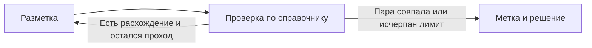

# Разметка обращений МОТИВ

`loop_agent.py` размечает 150 реплик из `messages.csv` по справочнику `intents.md`. Для каждой реплики он выбирает `intent_id` от 0 до 15 и решение `self`, `clarify` или `handoff`.

## Запуск в PowerShell

```powershell
.\.venv\Scripts\python.exe -m pip install -r requirements.txt
if (-not (Test-Path .env)) { Copy-Item .env.example .env }
```

Впишите `OPENAI_API_KEY` в `.env`. Ключ из `.env` имеет приоритет над переменной окружения PowerShell. При ошибке 401 замените ключ в источнике, указанном в сообщении программы. По умолчанию используется `gpt-5.4-mini`, модель можно поменять через `OPENAI_MODEL`.

```powershell
.\.venv\Scripts\python.exe loop_agent.py --id m001
.\.venv\Scripts\python.exe loop_agent.py
```

Первый запуск выводит метку, решение и пояснение для `m001`. Второй создаёт `submission.csv` в UTF-8 с колонками `id,intent_id,decision` и 150 строками в порядке шаблона. При ошибке обработки реплики программа выводит её ID и завершает прогон. Запись файла начинается после обработки всех строк.

## Как устроен цикл



Узел разметки получает сообщение абонента, а узел проверки сверяет предложенную пару с исходным текстом, пограничными правилами и полномочиями агента. При расхождении следующая разметка получает замечание проверяющего. Лимит по умолчанию составляет два прохода, его можно изменить через `--max-rounds`. Если расхождение сохраняется, в CSV попадает метка проверяющего, а терминал показывает ID для ручного просмотра.

## Актуальные результаты:

1. submission.csv (150 строк)
2. gpt-6.2-submission.csv (150 строк)
Общих ID: 150
Совпадает intent_id: 148/150 (98.7%)
Совпадает decision: 145/150 (96.7%)
Совпадают оба поля: 144/150 (96.0%)

Строк с различиями: 6
m009: (6, self) → (6, handoff)
  После кражи телефона просит заблокировать и восстановить номер.
m010: (4, self) → (13, self)
  Жалуется, что лимиты пакета не обновились после оплаты тарифа.
m071: (6, self) → (6, handoff)
  Просит заблокировать SIM. Для изменения статуса нужен оператор.
m095: (6, self) → (6, handoff)
  После потери телефона просит срочно заблокировать SIM.
m104: (6, self) → (6, handoff)
  Просит разблокировать номер после находки телефона.
m137: (0, handoff) → (14, self)
  Хочет включить рингбэктон, то есть мелодию вместо гудков для звонящего.

